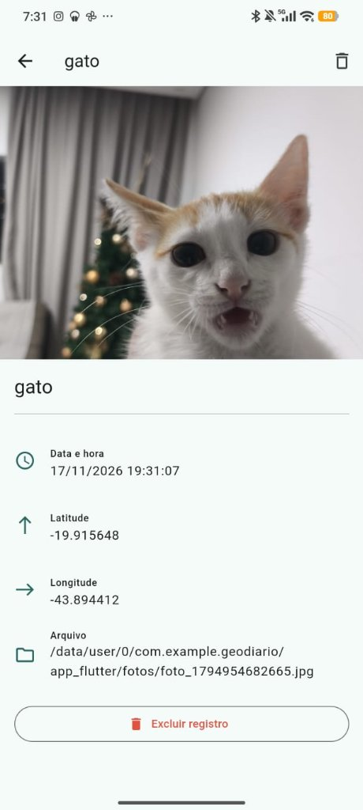
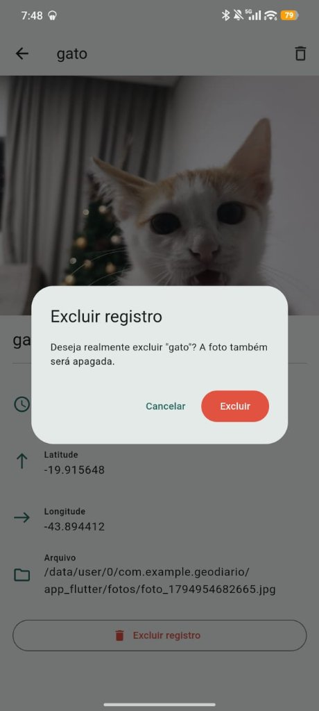
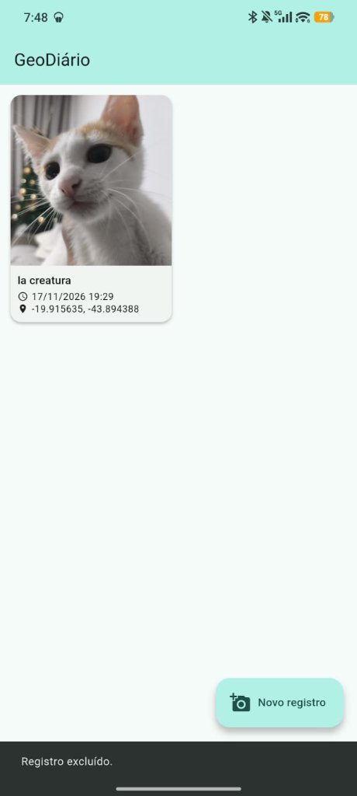

# GeoDiário

Aplicativo mobile desenvolvido em Flutter e Dart para registrar fotografias do dia a dia associando automaticamente a data, o horário e a localização geográfica (latitude e longitude) do momento da captura.

A ideia é simples e prática: tirar uma foto pela câmera, dar um título (e uma descrição, se quiser) e guardar tudo offline no próprio aparelho usando SQLite. A imagem fica salva no armazenamento interno do dispositivo, enquanto o banco registra o caminho do arquivo e os metadados da captura.

## Informações acadêmicas

- Autor: Pedro Henrique Vieira Hipólito
- Matrícula: D25213
- Curso: Ciência da Computação — Escola Superior Dom Helder Câmara
- Disciplina: Desenvolvimento para Dispositivos Móveis

## Funcionalidades implementadas

- **RF01 — Captura de fotografia**: abertura direta da câmera nativa do aparelho ao iniciar um novo registro (`image_picker`), permitindo também refazer a foto antes de salvar.
- **RF02 — Metadados do registro**: preenchimento automático da data/hora do momento da foto e busca automática das coordenadas de latitude e longitude via GPS (`geolocator`), além de campos para título (obrigatório) e descrição opcional. Tratamento de cenários com GPS desativado ou permissão negada (permitindo tentar novamente ou prosseguir sem coordenadas caso o usuário confirme).
- **RF03 — Armazenamento local**: cópia da fotografia capturada para a pasta interna de documentos do aplicativo (`path_provider`) e persistência do caminho da imagem junto dos demais dados no SQLite (`sqflite`).
- **RF04 — Consulta dos registros**: tela inicial exibindo uma galeria em grade de duas colunas ordenada dos registros mais recentes para os mais antigos, com suporte a gesto *pull-to-refresh*.
- **RF05 — Visualização e exclusão**: tela de detalhes com foto ampliável em tela cheia (gesto de pinça/zoom via `InteractiveViewer`), exibição formatada de data, coordenadas e caminho do arquivo, além de exclusão com diálogo de confirmação que remove tanto a linha no SQLite quanto a imagem do armazenamento local.

## Tecnologias e bibliotecas utilizadas

As versões exatas estão declaradas no `pubspec.yaml`:

| Tecnologia ou pacote | Finalidade no projeto |
|---|---|
| Flutter e Dart (`sdk: ^3.5.0`) | Base da interface em Material 3 e lógica da aplicação |
| `sqflite` (`^2.4.2`) | Banco de dados relacional SQLite embarcado no dispositivo |
| `path` (`^1.9.0`) | Construção segura de caminhos de arquivos e diretórios |
| `path_provider` (`^2.1.5`) | Acesso ao diretório de documentos interno do aplicativo para salvar as fotos |
| `image_picker` (`^1.1.2`) | Integração com a câmera do aparelho para captura de imagens |
| `geolocator` (`^14.0.2`) | Verificação de permissões de localização e obtenção de latitude e longitude via GPS |
| `intl` (`^0.20.2`) | Formatação de datas e horários (`dd/MM/yyyy HH:mm:ss`) |
| `cupertino_icons` (`^1.0.8`) | Conjunto padrão de ícones incluído no projeto Flutter |

## Organização do código

```text
lib/
├── main.dart                         # Ponto de entrada e tema Material 3
├── models/
│   └── registro.dart                 # Classe Registro e conversões toMap() / fromMap()
├── database/
│   └── database_helper.dart          # Inicialização do banco SQLite e operações CRUD
├── services/
│   ├── location_service.dart         # Acesso ao GPS e tratamento de permissões/erros
│   └── photo_service.dart            # Captura de foto, cópia local e remoção de arquivo
├── screens/
│   ├── home_screen.dart              # Galeria principal dos registros (RF04)
│   ├── novo_registro_screen.dart     # Captura pela câmera, GPS e formulário (RF01-RF03)
│   └── detalhes_screen.dart          # Visualização ampliada e exclusão (RF05)
├── widgets/
│   ├── registro_card.dart            # Card resumido exibido na grade da tela inicial
│   └── info_tile.dart                # Linha reutilizável de metadados nos detalhes
└── utils/
    └── formatters.dart               # Formatação de data/hora e coordenadas geográficas
```

### Responsabilidades

- `main.dart`: inicializa os bindings do Flutter e configura o `MaterialApp` com tema Material 3.
- `registro.dart`: define o modelo de dados `Registro` e os métodos de serialização para o SQLite (`toMap()` e `fromMap()`).
- `database_helper.dart`: centraliza a conexão singleton com o banco `geodiario.db` e implementa as operações `inserir`, `listarTodos`, `buscarPorId` e `excluir`.
- `location_service.dart`: encapsula a checagem de GPS ativo, solicitação de permissão ao sistema e captura da posição atual com timeout.
- `photo_service.dart`: abre a câmera, copia o arquivo temporário para `fotos/` dentro do diretório do aplicativo e trata a remoção do arquivo na exclusão.
- `home_screen.dart`: lista os registros salvos em grade, com atualização automática após cadastros ou exclusões.
- `novo_registro_screen.dart`: orquestra foto, timestamp, captura de coordenadas, validação do formulário e gravação local.
- `detalhes_screen.dart`: exibe a fotografia em destaque (com zoom em tela cheia), mostra os metadados e executa a exclusão segura do registro.

## Banco de dados SQLite

- Arquivo do banco: `geodiario.db`
- Versão do schema: `1`
- Tabela: `registros`

### Estrutura da tabela

| Coluna | Tipo SQLite | Restrições e finalidade |
|---|---|---|
| `id` | `INTEGER` | `PRIMARY KEY AUTOINCREMENT` — identificador único gerado pelo SQLite |
| `titulo` | `TEXT` | `NOT NULL` — título informado no cadastro |
| `descricao` | `TEXT` | Descrição opcional informada pelo usuário |
| `caminho_foto` | `TEXT` | `NOT NULL` — caminho absoluto da foto `.jpg` salva no diretório do app |
| `data_hora` | `TEXT` | `NOT NULL` — timestamp da captura em formato ISO-8601 |
| `latitude` | `REAL` | Latitude retornada pelo GPS (nula caso salva sem localização) |
| `longitude` | `REAL` | Longitude retornada pelo GPS (nula caso salva sem localização) |

### SQL de criação

```sql
CREATE TABLE registros (
  id           INTEGER PRIMARY KEY AUTOINCREMENT,
  titulo       TEXT    NOT NULL,
  descricao    TEXT,
  caminho_foto TEXT    NOT NULL,
  data_hora    TEXT    NOT NULL,
  latitude     REAL,
  longitude    REAL
);
```

### Tratamento dos dados e operações implementadas

No `DatabaseHelper`, o CRUD foi implementado com os métodos `inserir(Registro)`, `listarTodos()`, `buscarPorId(int)` e `excluir(int)`. As fotos não são gravadas como `BLOB` dentro do SQLite para evitar inflar o banco; apenas o caminho em disco (`caminho_foto`) vai para a tabela. A data e o horário são salvos como texto ISO-8601 (`DateTime.toIso8601String()`) e formatados apenas na exibição visual.

## Permissões configuradas

No Android (`android/app/src/main/AndroidManifest.xml`), dentro da tag `<manifest>` (sem o atributo depreciado `package`, utilizando `namespace = "com.example.geodiario"` no Gradle):

```xml
<uses-permission android:name="android.permission.CAMERA" />
<uses-permission
    android:name="android.permission.READ_EXTERNAL_STORAGE"
    android:maxSdkVersion="32" />

<uses-permission android:name="android.permission.ACCESS_FINE_LOCATION" />
<uses-permission android:name="android.permission.ACCESS_COARSE_LOCATION" />
```

No iOS (`ios/Runner/Info.plist`), também foram declaradas as descrições de privacidade exigidas pelo sistema (`NSCameraUsageDescription`, `NSPhotoLibraryUsageDescription` e `NSLocationWhenInUseUsageDescription`).

## Como executar

### Instalação direta no Android (APK)

Caso queira testar direto no celular sem precisar compilar localmente, o pacote `.apk` gerado automaticamente via GitHub Actions está disponível na aba Releases:

- Download: [app-release.apk (v1.0.0)](https://github.com/hipolitopeedro/geodiario/releases/latest/download/app-release.apk)

### Executando pelo código-fonte

Pré-requisitos: Flutter SDK e Android SDK configurados, além de um aparelho Android com Depuração USB ativada ou emulador disponível.

1. Clone o repositório e acesse a pasta do projeto.
2. Instale as dependências:

```bash
flutter pub get
```

3. Verifique a análise estática e os testes unitários:

```bash
flutter analyze --no-fatal-infos
flutter test
```

4. Liste os dispositivos conectados e execute a aplicação:

```bash
flutter devices
flutter run
```

## Capturas de tela

Abaixo estão as telas principais testadas diretamente em um aparelho Android físico:

| Tela inicial (Galeria) | Novo registro (Câmera + GPS) | Detalhes do registro |
|---|---|---|
|  |  |  |
| Confirmação de exclusão | Galeria atualizada após exclusão |
|---|---|
|  |  |

## Checklist de testes manuais

- [X] Cadastro completo com fotografia pela câmera, título, data/hora automática e coordenadas GPS.
- [X] Validação de título obrigatório e exigência de fotografia antes de salvar.
- [X] Exibição dos registros em grade na tela inicial com atualização após novo cadastro.
- [X] Visualização da fotografia e metadados completos na tela de detalhes.
- [X] Formatação legível de data e horário (`DD/MM/AAAA HH:mm` na galeria e `DD/MM/AAAA HH:mm:ss` nos detalhes).
- [X] Exclusão com caixa de confirmação removendo o registro do SQLite e o arquivo `.jpg` local.
- [X] Persistência dos registros e das imagens após fechar e reabrir o aplicativo no aparelho.
- [X] Validação estática (`flutter analyze --no-fatal-infos`) e teste unitário (`flutter test`) sem erros.

